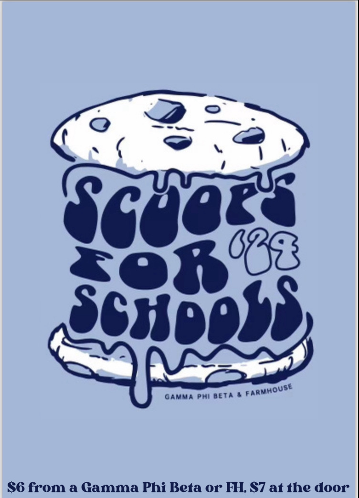
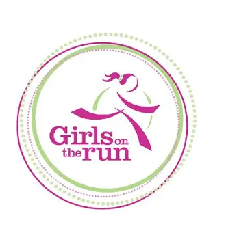
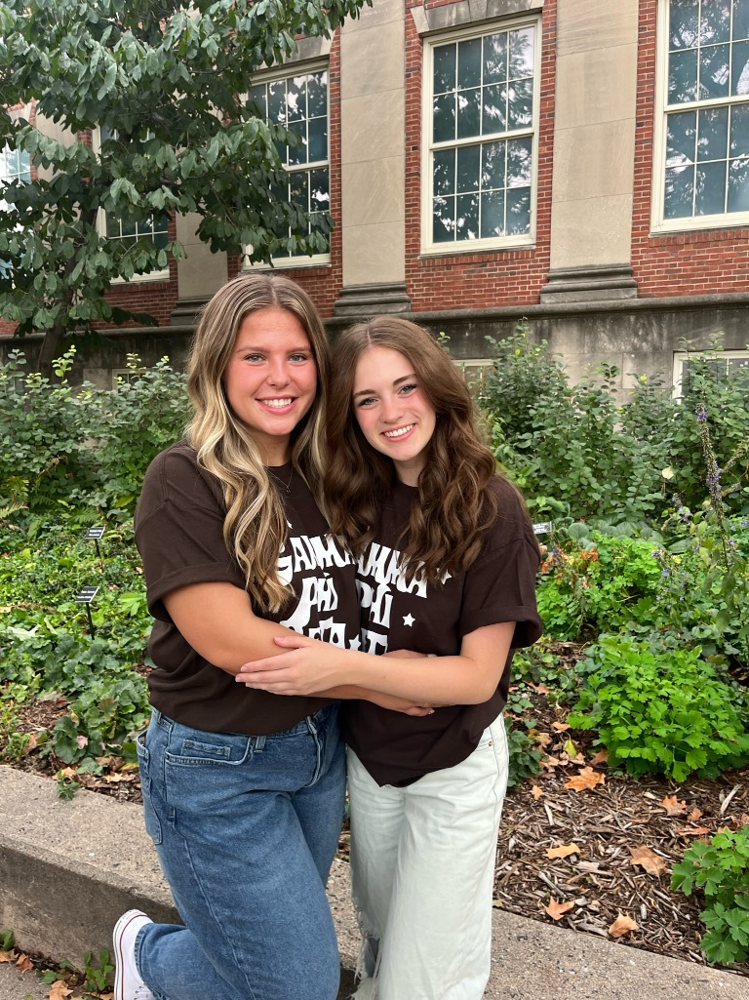
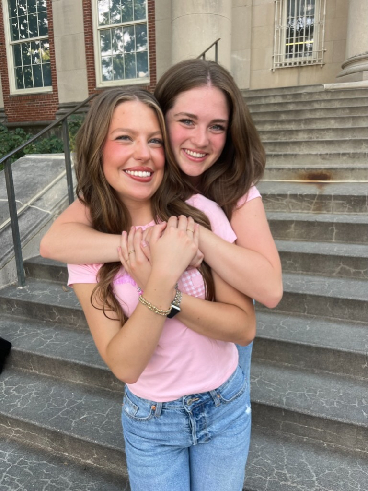
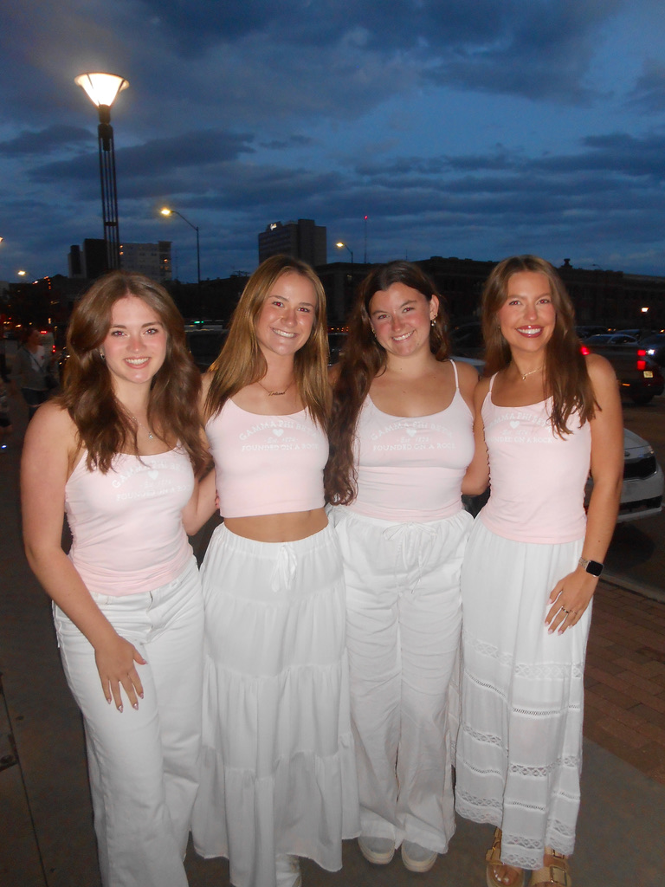
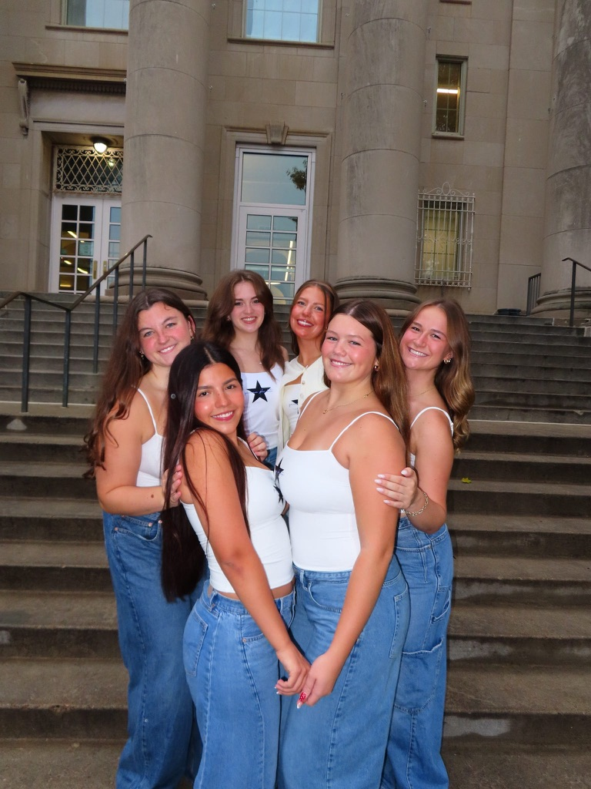

<section class="about-intro" aria-labelledby="about-me-title">
<h2 id="about-me-title">A Little About Me</h2>

I am a senior at the University of Nebraska–Lincoln majoring in Computer Science with a minor in Mathematics. I am particularly interested in programming, data science, artificial intelligence, and large language models, and I enjoy exploring how these technologies are being applied to real-world problems.

I love opportunities to learn new technologies, work through challenging problems, and turn ideas into projects I can share with others. Through my coursework and personal projects, I have developed a passion for using programming to combine technical problem-solving with creativity to build useful applications that produce meaningful results.

Outside of academics, I enjoy researching new topics, being involved in my sorority, and finding new ways to learn and grow. I am excited to continue developing my skills, exploring new technologies, and discovering where my career in computer science will take me.

</section>

<section class="about-topic-section about-interest-banner" aria-labelledby="areas-of-interest">

  
What I’m curious about

  <h2 id="areas-of-interest">Areas of Interest</h2>

<ul class="skill-list about-interest-list">
    <li>Data Science</li>
    <li>AI &amp; Machine Learning</li>
    <li>Data Visualization</li>
    <li>LLMs</li>
    <li>Software Development</li>
</ul>
</section>

<section class="about-topic-section academic-journey-section" aria-labelledby="academic-journey">

  
Where I’m headed

  <h2 id="academic-journey">My Academic &amp; Career Journey</h2>

Throughout my time studying Computer Science, I have enjoyed the precision of programming, along with the creativity and problem-solving it involves. I have developed a strong interest in artificial intelligence, specifically Large Language Models. Through my experience developing and optimizing LLM-as-a-Judge evaluation methods, I have grown increasingly intrigued with how these processes can be refined. I hope to continue expanding my knowledge of LLMs and AI and explore more topics that challenge me and allow me to grow in my technical and professional skills.

</section>

<section class="sisterhood-section" aria-labelledby="gamma-phi-beta">

Leadership &amp; Community

<h2 id="gamma-phi-beta">Gamma Phi Beta</h2>

<section class="sisterhood-group philanthropy-group" aria-labelledby="girls-on-the-run">
<h3 id="girls-on-the-run">Giving Back Through Philanthropy</h3>

One of my favorite parts of being a member of Gamma Phi was the opportunity to participate in our philanthropy and give back to the community. Gamma Phi’s philanthropy is Girls on the Run, an after-school program that helps young girls build confidence, develop healthy habits, and recognize their potential.

Throughout the year, our chapter hosted a variety of fundraising events to support Girls on the Run. We sold ice cream, hosted pumpkin-carving events, held karaoke nights, and organized other activities that brought our community together. All of the funds raised through these events were donated to Girls on the Run.

Members of our chapter also had the opportunity to serve as coaches for the girls in the program. While I was not able to be a coach myself, I always looked for opportunities to help with activities, support practices, and participate in the girls’ practice 5K.

Twice a year, Girls on the Run hosts a 5K for their program, and our entire chapter volunteers at the event. There are many ways to get involved, from checking participants in to helping the girls with their hair and accessories, or my personal favorite, being a cheerleader for the girls. We would spread out along different points of the 5K course and cheer on the girls as they ran by. It was so cute watching all their faces light up. I am incredibly grateful for the opportunities Gamma Phi has given me to be involved in Girls on the Run.

<figure class="sisterhood-photo">

</figure>

<figure class="sisterhood-photo girls-run-logo-photo">

</figure>

</section>

<section class="sisterhood-group big-little-group" aria-labelledby="big-little">
<h3 id="big-little">Big / Little - Memories through the years</h3>

Another fun part of being in a sorority is getting to participate in Big/Little. As a sophomore, you get to be paired with a new freshman member as their “Big.” The week leading up to the Big/Little reveal is filled with surprises, gifts, and Gamma Phi merchandise as you get to learn more about each other and make them feel welcomed and excited to be part of the chapter.

Being a Big means you become a mentor and someone your Little can turn to as they adjust to college life. Bigs help their Littles become familiar with campus and learn Gamma Phi traditions and expectations. I really enjoyed being someone my Little could rely on and making her transition into college a little easier.

One of my favorite things to do with my Little is go on coffee and study dates. Whether we are catching up over coffee or working on assignments together, I am so grateful to have built a friendship that means so much to me.

<figure class="sisterhood-photo">

<figcaption>Freshman</figcaption>
</figure>

<figure class="sisterhood-photo">

<figcaption>Sophomore</figcaption>
</figure>

<figure class="sisterhood-photo">

<figcaption>Junior</figcaption>
</figure>

<figure class="sisterhood-photo">

<figcaption>Senior</figcaption>
</figure>

</section>

</section>

<section class="about-topic-section beyond-classroom" aria-labelledby="beyond-classroom">

  
A little more personally

  <h2 id="beyond-classroom">Beyond the Classroom</h2>

Outside of school, I really enjoy spending my time with my nose in a book. One of my favorite books I've read is The Tao of Pooh by Benjamin Hoff, which introduces the philosophy of Taoism through the characters of Winnie-the-Pooh. The book explores themes of finding peace and happiness in everyday life. It remains one of my favorite reads because Hoff presents complex philosophical ideas in a lighthearted and easy to understand way.

My current read is The Prophet by Kahlil Gibran, a collection of poetic reflections on life, love, loss, happiness, and many other aspects of human experience. The book follows a man preparing to leave a town where he has resided for twelve years, as the townspeople gather to ask him questions before he departs. I enjoy both of these books because they offer unique perspectives on life and encourage me to think differently about the world and the challenges we face.

Another hobby I enjoy is crocheting, which I taught myself a few summers ago. I especially enjoy making little crocheted animals for my sisters and other family members. I love having a creative outlet that allows me to learn something new and make personalized gifts for the people I care about.

</section>
