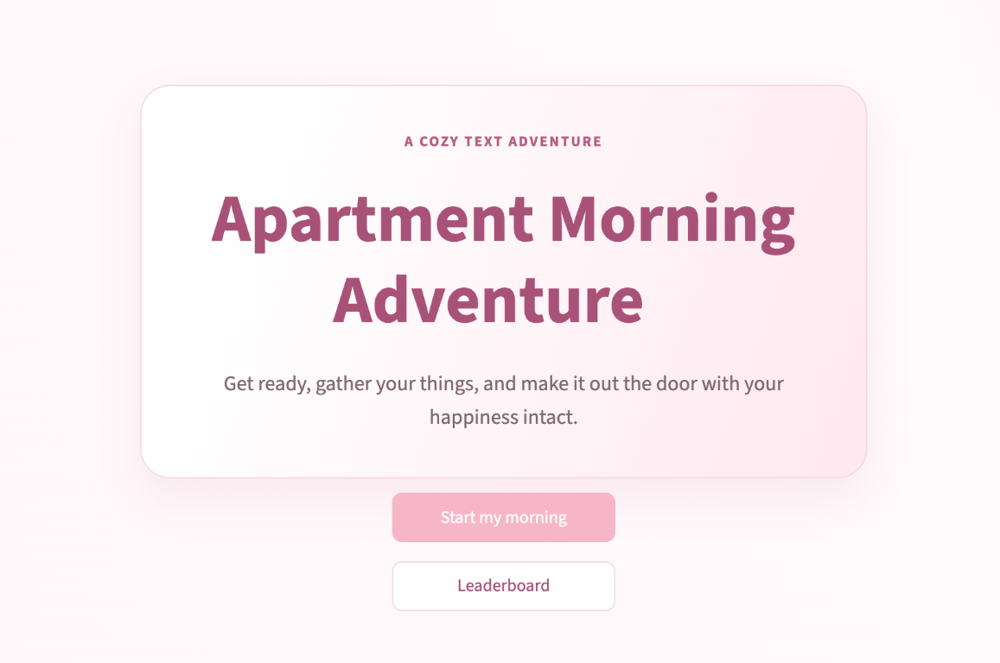
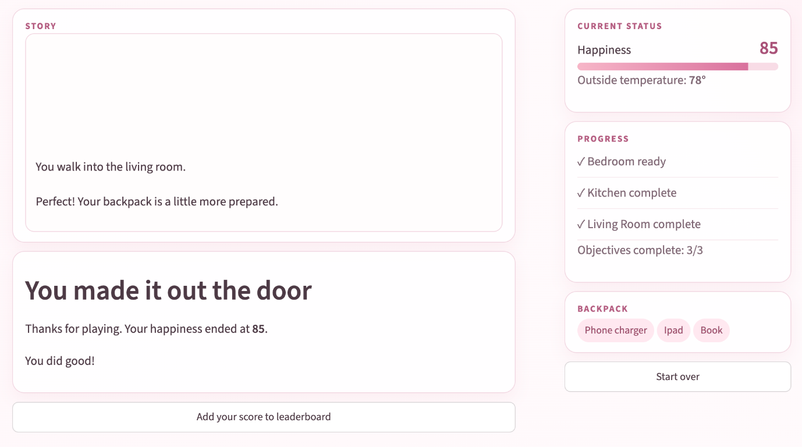
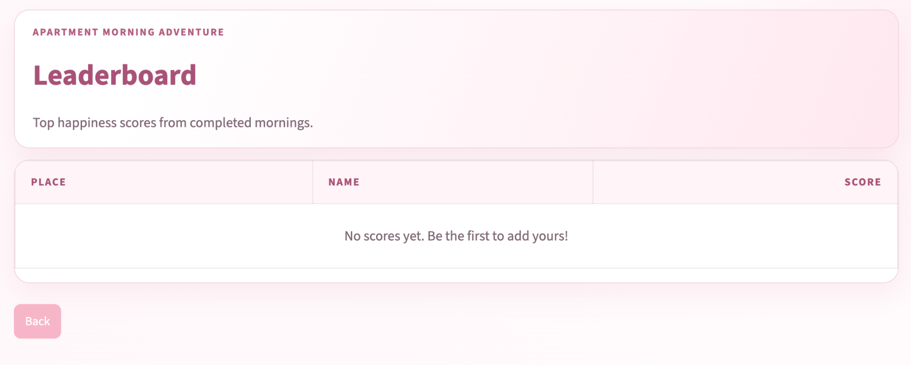

<article class="project-block" aria-labelledby="apartment-morning-adventure">

  

  
Interactive game

  <h3 id="apartment-morning-adventure">Apartment Morning Adventure</h3>
  
A cozy text adventure where you get ready, gather your things, and try to make it out the door with your happiness intact.

  <a class="btn btn-primary" href="https://textadventure-redesigned.streamlit.app/" target="_blank" rel="noopener noreferrer">Try the live app ↗(opens in a new tab)</a>
  Built with Streamlit
  

<figure class="gameplay-screenshot">

</figure>

<figure class="gameplay-screenshot">

</figure>

<figure class="gameplay-screenshot">

</figure>

<section class="project-details" aria-labelledby="adventure-details">

  
Behind the project

  <h3 id="adventure-details">A favorite project, revisited</h3>
  
I originally created this project during my freshman year of college. It was a text-based adventure game and my first large-scale programming project. I really enjoyed getting the opportunity to combine technical skills with creative storytelling. The game allows players to explore an apartment and prepare for their day through interactive mini-games and decision-based challenges. Players can complete tasks such as styling their hair and makeup, gathering essential items for their backpack, and making breakfast. Each decision can affect their happiness score, and choosing to make pancakes even reveals a fun surprise!

  
For this updated version, I took my original Python program and redesigned it with a user-friendly interface using Streamlit. The new interface organizes the game into separate sections, allowing players to keep track of their health, completed rooms, and backpack items throughout the experience. I also replaced text-based commands with interactive buttons, making the game more intuitive to navigate.

  
This project has always been one of my favorites because it was where I first got to experience the creativity and excitement of building a large program from the ground up. Revisiting it gave me the opportunity to see how much I've grown as a programmer while bringing new life to a project that means a lot to me. I was also able to incorporate more of my personality into the design and create an experience that feels uniquely my own. Feel free to play the game and add your name to the leaderboard to compete for first place!

</section>
</article>

  
More to come

  
More projects will be showcased here as they're ready

<a class="text-link" href="https://github.com/KeiraRish?tab=repositories" target="_blank" rel="noopener noreferrer">Browse GitHub ↗(opens in a new tab)</a>

